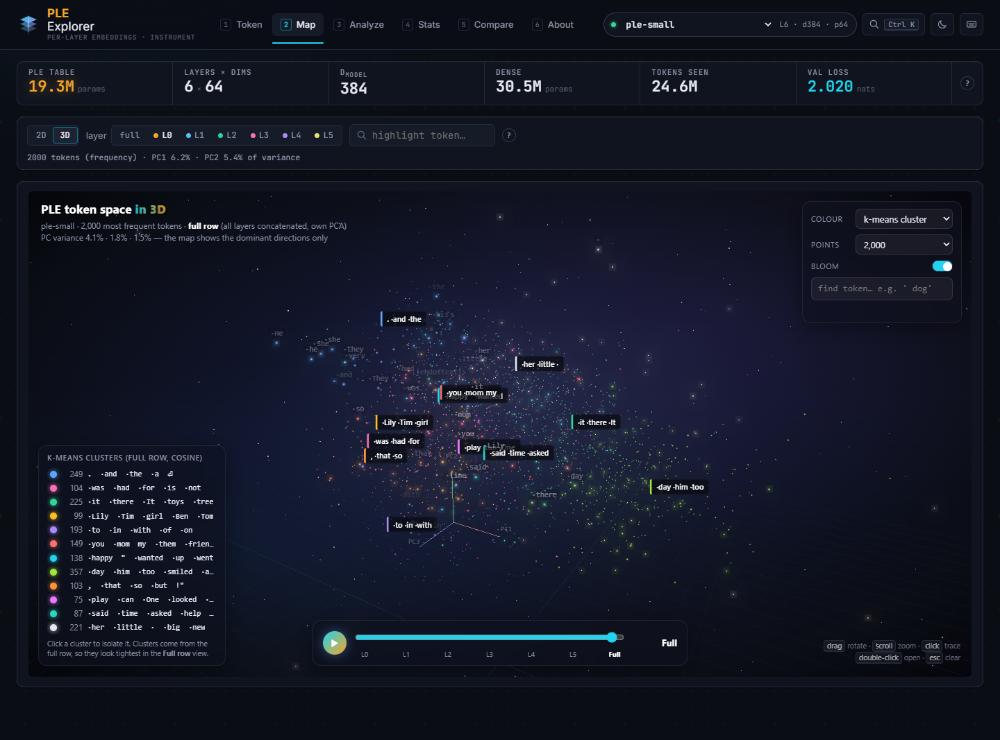

# PLE Lab: Per-Layer Embeddings for Gemma 3n-style on-device LLM research

PLE Lab trains a small GPT with optional **Per-Layer Embeddings (PLE)** on TinyStories. It measures PLE table access from GPU memory, CPU RAM, and memory-mapped files that stand in for SSD or phone flash. It also lets you inspect trained token vectors by layer. This is an independent, small-scale experiment inspired by the Gemma 3n PLE design. It does not implement Gemma 3n's AltUp streams. It does **not** contain Gemma 3n weights or reproduce Gemma 3n results.

**Explore:** [Published results](https://avinashistoocool.github.io/PLE-Lab/) · [Browser-only token explorer](https://avinashistoocool.github.io/PLE-Lab/explorer.html) · [Source](https://github.com/Avinashistoocool/PLE-Lab)

## What this project tests

Ordinary token embeddings feed the model's initial hidden state. PLE adds a **separate token-indexed table** with a small vector for each transformer layer. The model combines each layer's token vector with a context-derived vector. A gate injects the result after that layer's attention and MLP. This is not word2vec: the vectors are learned as part of a language model and can differ across layers.

```text
token IDs ──► ordinary embeddings + positions ──► initial state x₀ ──► GPT blocks ──► logits
    │                                            │                 ▲
    └──► PLE table row ──► slice for each layer ─┼─► per-layer input │
                          (L × p values)        └─► context vectors ┘
                                  per block: gate(hidden state) × per-layer input
                                             └─► project + normalize + add to hidden state

PLE table source: GPU  |  CPU / pinned RAM  |  mmap fp16 / int8 (SSD-backed file)
                                           └─► optional small GPU row cache
```

The token IDs of a forward pass are known before that pass runs. Each newly generated token needs its own row when it enters the next pass. The offload engine fetches **PLE table rows**, not whole transformer layers or all model weights. Dense weights remain on the device in the GPU benchmarks. Memory-mapped files approximate flash-backed access, but the measured runs used a warm OS page cache.

- **Train and compare:** a 6-layer baseline and a PLE model with the same dense configuration and token budget.
- **Offload token rows:** compare GPU, CPU, pinned CPU, fp16/int8 mmap, GPU row caches, and prefetching.
- **Inspect interpretable token vectors:** compare per-layer slices, cosine nearest neighbours, norm and frequency patterns, PCA maps, gates, and ablations. These views support interpretation; they do not prove a layer has a single semantic role.
- **Choose an explorer:** the [browser-only subset](https://avinashistoocool.github.io/PLE-Lab/explorer.html) shows the top 2,000 trained tokens, a morphing 3D PCA map, nearest neighbours, and per-layer vectors without a backend. The full model-backed FastAPI/PyTorch explorer runs **locally** and adds inference, ablations, and run comparisons.



## Quick start (PowerShell, from a fresh clone)

Use Python with the packages in `requirements.txt`. Run these commands from the repository root. Download TinyStories before training; its tokenized files and trained checkpoints are **not included** in the public repository.

```powershell
git clone https://github.com/Avinashistoocool/PLE-Lab.git
cd .\PLE-Lab
python -m pip install -r requirements.txt
python -m ple_lab.data
python -m ple_lab.train --name quick-ple --preset tiny --ple-dim 32 --max-iters 20 --batch-size 4 --eval-iters 2 --eval-interval 10
python -m explorer.server --runs runs --port 8765
```

Open [http://127.0.0.1:8765](http://127.0.0.1:8765) and select `quick-ple`. The default data command downloads up to 300 MB of TinyStories training text **and** the validation text, then writes `data\tinystories\train.bin` and `val.bin`. Downloads and tokenization can take time. The short training run only checks the workflow; it does not reproduce the measured results. Training uses CUDA if available, or CPU otherwise. The local explorer defaults to CPU.

For a UI check without training, run `python -m explorer.make_demo_run` before starting the server and select `demo-random`. Its vectors are **random**, not trained. The server needs a local run with `dense.pt`; the tracked `runs\*\config.json` files and the published results do not include checkpoints. The browser-only subset uses precomputed data and does not provide model inference.

## Reproduce the measured runs

After `python -m ple_lab.data`, use the small preset and the recorded settings below. These runs take much longer than the quick start, especially on CPU. Keep the two checkpoints if you want to use Compare in the local explorer.

```powershell
python -m ple_lab.train --name baseline-small --ple-dim 0 --max-iters 3000 --batch-size 16 --grad-accum 2
python -m ple_lab.train --name ple-small --ple-dim 64 --max-iters 3000 --batch-size 16 --grad-accum 2
python scripts\compare_runs.py
python -m explorer.server --runs runs --port 8765
```

Optional GPU offload benchmarks use the trained run. The synthetic benchmark creates a **random-initialized** larger table and model in `runs\synthetic-big`; allow disk and memory for its fp16 and int8 table files. Use `--device cuda` only when CUDA is available. The benchmark writes new reports to `results\offload\`.

```powershell
python -m ple_lab.offload.bench --run runs/ple-small --device cuda
python -m ple_lab.offload.bench --synthetic --device cuda
```

## Measured results

Training used an RTX 4050 Laptop GPU (6 GB), one seed per model, and 24.576 million sampled training-token positions each (3,000 steps × 16 × 2 × 256) from a 72.4M-token training split. Validation loss is cross-entropy in nats/token on fixed sampled validation windows. Loss is lower when better; the PLE model has more parameters.

| Model | PLE dim | Validation loss | Total parameters | PLE table | Train time |
|---|---:|---:|---:|---:|---:|
| Baseline | 0 | 2.0288 | 30.04M | 0 | 11.8 min |
| PLE | 64 | 2.0198 | 49.80M | 19.32M | 15.1 min |

The 0.009 nats/token difference comes from one seed per model. The PLE model also has more parameters and a longer training time. The difference is **not** evidence of a reliable improvement. Sources: [baseline run metadata](runs/baseline-small/config.json) and [PLE run metadata](runs/ple-small/config.json).

| Separate measurement | Observation | Scope |
|---|---|---|
| Synthetic-big table offload | A 5% static-top-k GPU cache cut table VRAM from 294.75 to 14.74 MiB (95% less), with a 95.5% hit rate. Prefill throughput was 4,387 vs 5,453 tokens/s with the full table on GPU. | Random-initialized 154.5M-parameter PLE table; [benchmark JSON](results/offload/synthetic-big-20261112-192517.json) |
| Trained-table int8 storage | Validation loss was 2.01533 (fp16) vs 2.01535 (int8); Δ ≈ +0.00002. | Fixed validation windows, 50 batches × 16 × 256 tokens; [benchmark JSON](results/offload/ple-small-20261112-192148.json) |
| Trained-model ablation | Removing the PLE **token part** at all layers raised mean loss by +0.621 nats. The context part stayed active. | 25,500 validation predictions; [explorer findings](results/explorer_findings.json) |

The offload tests ran under Windows/WDDM on a shared laptop GPU. Throughput is noisy. mmap results reflect a warm OS page cache, **not** cold SSD latency or a phone deployment. The benchmark's full-model decode repeatedly evaluates a sliding window; it has no KV cache. The table-only `decode-1` workload is separate. This project tests an on-device LLM *design idea*, not end-to-end phone performance.

## Documentation

- [Model and checkpoint contract](docs/CONTRACT.md) — table layout, model paths, and run files.
- [Offload engine and full benchmark tables](docs/OFFLOAD.md) — sources, cache policies, workload definitions, and caveats.
- [Local explorer and findings](docs/EXPLORER.md) — visualizations, APIs, ablation conventions, and limitations.
- [Published static results](https://avinashistoocool.github.io/PLE-Lab/) — read the results without local checkpoints.
